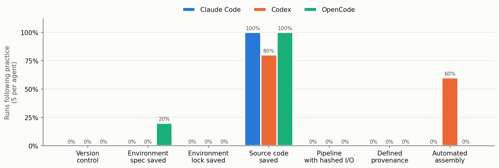
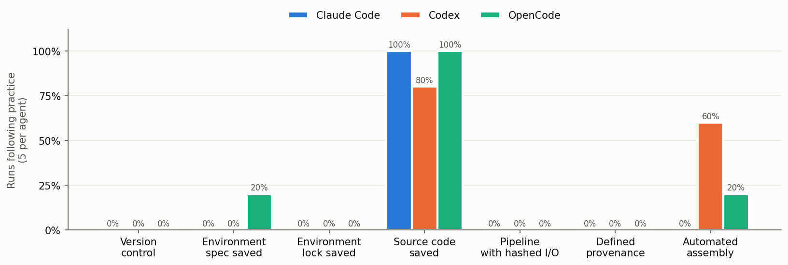
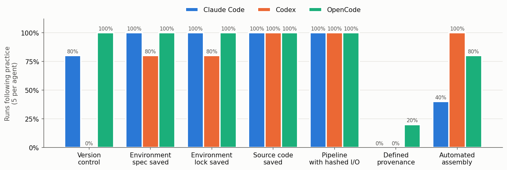
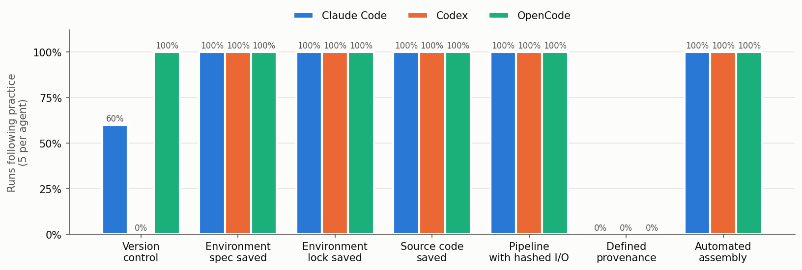

AI coding agents like Claude Code, Codex, and OpenCode are
amazing little information machines, but their use comes with some risk.
You've surely heard of the hallucination problems,
where the large language model (LLM) seems to simply make things up,
but what about their use in research computations?
These agents are very good at writing code and analyzing data.
They'll produce beautiful HTML artifacts filled with rich figures
and tables,
but do they work in a verifiable, transparent, and reproducible way,
such that they could be trusted to produce scientific evidence
and fully describe how they did it?

To find out, I set up a little computational experiment.
Claude Code, Codex, and OpenCode were all given the same prompt to
analyze and visualize a dataset, then create a short report.
Each agent was run
<!-- ckvalue _data/ai-agent-behavior/reproducibility.json summary.default.by_agent.claude.n_runs -->5
<!-- /ckvalue -->
times in a "sandbox" so it mimicked
a fresh install with a new session on a new machine.
Their work was evaluated based on whether or not they followed
these computational reproducibility best practices:

1. Use version control to keep a history of all file changes.
2. Use an environment manager to record the exact software
   package versions used, i.e., save a "lock file."
3. Use a pipeline or build system that tracks (i.e., hashes) the content in
   input and output files.
4. Define the provenance (or source) for any data imported or created by hand.
5. Automatically assemble composite artifacts like papers and reports
   from their components (figures, tables, results),
   rather than copying them in by hand.

The implication is that if the agents follow these practices,
it will be quick and easy to verify that the outputs were indeed produced
by the inputs and process definitions (scripts, notebooks, etc.).
The goal is to create something runnable that you don't actually need to run
to be able to understand how the outputs were created,
which is especially important for expensive, long-running tasks like
large-scale simulations.
With verification made easier, we can spend more time and effort validating
that the approach properly answers the research questions.

Figures 1 and 2 show the results
of 5 runs for each agent, with figure 2 showing what happens when
Git is installed on the machine.
I'm not sure if I find this surprising,
but when they weren't asked to work reproducibly,
the agents basically never did.
All saved their source code with the exception of one Codex run,
which sent raw text directly into R.
Only one OpenCode run saved an environment spec file (requirements.txt),
but it didn't include exact versions, so it doesn't count as passing
rule 2.
None used version control, regardless of whether or not Git was installed.
Codex did the best by far automatically assembling the report
with a script instead of manually inserting the values,
but didn't do it for every run.
OpenCode tried once out of its ten runs and Claude Code never did.

Claude Code made an interesting mistake that shows the importance of
automating the propagation of results into documents.
In one run, it printed an estimated value from the analysis script,
but the value it copied into the report was off by 0.1,
since it ran a one-off command to average together rounded values
instead of taking an average directly from the results.

_Figure 1. The fraction of runs where each agent used various practices on a machine without Git installed._

_Figure 2. The same conditions as figure 1 except with Git installed._

Of course I can't get through a post on my own website without
shilling some of my free software, so I repeated the same experiment
with "Use Calkit." added to the prompt. That's it---just two extra words
and everything else left as is.

This (also maybe not surprisingly) bumped reproducibility rates up
significantly.
All agents saved their source code and used an I/O hashing pipeline.
Nearly all used good environment management practices.
One interesting outlier was Codex,
which never used version control in any run.
OpenCode was the only agent that actually attempted to define the provenance
of the raw data, but only in one instance.
On the whole, however, OpenCode did the best, so if you're looking
for the most transparent and reproducible agent,
it might be your best bet.
It's also the only one whose source code is openly available,
and you can easily set it to use open-weight models.

_Figure 3. Agent reproducibility practice rates when told to use Calkit._

Next I ran another set of tests with the "use Calkit" prompt,
but with Calkit's agent skills installed.
This especially helped in the automated document assembly category,
but using version control and
attempting to define the provenance for the raw data were still
sorely lacking.
That's good fodder for improvement and retesting,
though the prospect of automatically testing agent skills in CI checks
feels exhausting already.

_Figure 3. Agent reproducibility practice rates when told to use Calkit with its agent skills installed._

<!-- TODO: cite recent blog where copy/paste errors were common
https://babieslearninglanguage.blogspot.com/2026/11/an-ai-audit-of-my-works-computational.html
-->

AI agents make producing research outputs so much faster.
This experiment itself (but not this writing)
was put together with Claude Code and I think
it would have taken at least ten times longer if done by hand.
However, the bottleneck
has now shifted to verification and validation---checking that
the outputs were generated as described, and that they actually back
up the claims.
For verification, following reproducibility best practices is crucial,
because you can trace through the exact path taken to produce each
output. You don't need to simply take the agent's word for it when
it tells you how something was created.

This study was done in a
[Calkit project](https://github.com/petebachant/ai-agent-behavior),
which you could try to reproduce (`calkit run`),
though I suppose it would be more interesting
to try replicating (`calkit run --force`).
In any case, better reproducibility in your agentic analysis workflows
is two words away: just tell your agents to use Calkit.
